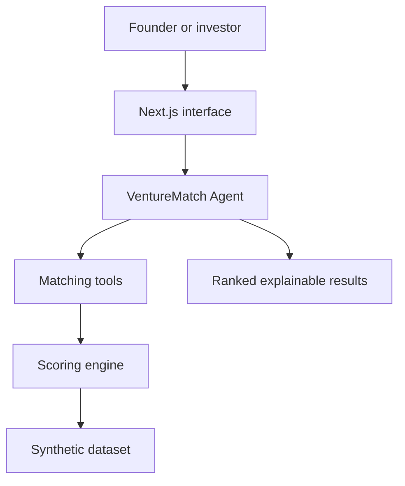

# VentureMatch AI

**VentureMatch AI is an agentic investment-discovery platform that produces explainable matches between founders and venture-capital investors.**

Built for the OpenAI × Istanbul Slush'D hackathon.

> **Project status:** Repository foundation and architecture are complete. The matching engine, agent tools, API, and user interface are the next implementation stages.

## The problem

Founders often spend significant time approaching investors whose investment thesis, stage, geography, or ticket size does not fit their business. Investors face the opposite problem: large numbers of opportunities, inconsistent pitch information, and limited time for initial screening.

VentureMatch AI reduces this discovery friction by analysing both sides of the market and showing **why** a founder and investor may be compatible.

## The solution

The platform provides two user modes:

### Founder mode

A founder submits a company profile and investment objective. The VentureMatch Agent filters unsuitable investors, ranks the remaining candidates, and explains the strongest matches.

### Investor mode

An investor submits an investment thesis and portfolio profile. The agent identifies suitable businesses, evaluates portfolio compatibility, and explains opportunities for strategic fit or diversification.

## Why this is agentic

VentureMatch is not a chatbot placed on top of a static list. The agent receives a goal, decides which matching tools to use, and produces a structured result from retrieved evidence.

The intended workflow is:

1. Interpret the user's objective.
2. Analyse and normalise the submitted profile.
3. Apply hard eligibility filters.
4. Call the compatibility-scoring tools.
5. Examine portfolio fit when relevant.
6. Rank the candidates.
7. Explain the results using only available evidence.
8. Refine the analysis conversationally when the user changes a constraint.

## System architecture



The language model controls the workflow and explanation, while deterministic code performs filtering and scoring. This separation keeps recommendations testable and reduces unsupported claims.

## Matching model

The first scoring model uses the following provisional weights:

| Factor | Weight |
|---|---:|
| Industry alignment | 25% |
| Funding-stage alignment | 20% |
| Ticket-size compatibility | 20% |
| Semantic thesis similarity | 15% |
| Geographic alignment | 10% |
| Portfolio compatibility | 10% |

Hard constraints are applied before scoring. Money is compared in USD using a timestamped FX snapshot while preserving the user's original currency. Funding-stage results distinguish an investor's normal mandate from clearly labelled exploration matches; neither semantic similarity nor stage exploration overrides other hard constraints.

## Planned agent tools

| Tool | Responsibility |
|---|---|
| `analyze_profile` | Validate and normalise a founder or investor profile |
| `search_investors` | Retrieve investors that satisfy founder-side constraints |
| `search_businesses` | Retrieve businesses that satisfy investor-side constraints |
| `score_matches` | Calculate and rank compatibility scores |
| `analyze_portfolio_fit` | Evaluate strategic fit, overlap, and diversification |
| `retrieve_match_evidence` | Return the profile fields supporting an explanation |

## Repository structure

```text
venturematch-ai/
├── frontend/             # Next.js user interface
├── backend/              # FastAPI, agent orchestration, and matching engine
├── data/                 # Synthetic business, investor, and portfolio data
├── docs/                 # Architecture and product documentation
├── .env.example          # Required environment-variable template
├── .gitignore            # Node, Python, editor, and local-data exclusions
└── README.md
```

## Technology direction

| Layer | Planned technology |
|---|---|
| Frontend | Next.js, TypeScript, Tailwind CSS |
| Backend | Python, FastAPI, Pydantic |
| Agent layer | OpenAI tool calling with structured outputs |
| Matching | Deterministic filters, weighted scoring, and embeddings |
| Development data | Version-controlled synthetic JSON |
| Production persistence | SQLite initially; replaceable later |

## Local configuration

The applications have not yet been bootstrapped, so there are no run commands at this stage. When implementation begins:

1. Clone the repository.
2. Copy `.env.example` to `.env`.
3. Add local secrets to `.env`; never commit them.
4. Follow the service-specific instructions in `frontend/README.md` and `backend/README.md`.

```bash
git clone https://github.com/Dannyclops/venturematch-ai.git
cd venturematch-ai
```

## MVP roadmap

- [x] Define the product scope and exclusions
- [x] Define the agentic architecture
- [x] Create the repository structure
- [x] Define Pydantic and TypeScript schemas
- [x] Generate synthetic business and investor datasets
- [x] Add multi-currency normalization and flexible stage policies
- [x] Implement deterministic eligibility filters
- [ ] Implement and test the compatibility score
- [ ] Expose matching functions as agent tools
- [ ] Build the VentureMatch Agent
- [ ] Build the FastAPI endpoints
- [ ] Build founder and investor interface flows
- [ ] Add conversational refinement
- [ ] Run scenario-based evaluations
- [ ] Deploy and record the hackathon demo

## MVP boundaries

The hackathon MVP will **not** provide:

- Company valuation
- Acquisition or business-sale functionality
- Founder-investor messaging
- Automated due diligence
- Financial or legal advice
- Live proprietary investment databases
- Automated deal execution

These exclusions keep the demo focused on explainable discovery and compatibility matching.

## Responsible-use principles

- Recommendations must be traceable to supplied profile information.
- The agent must distinguish known facts from interpretations.
- Missing data must reduce confidence instead of being invented.
- A match is a discovery recommendation, not investment advice.
- Synthetic demo entities must be clearly identified as fictional.

## Documentation

- [`docs/architecture.md`](docs/architecture.md) explains component responsibilities, the agent execution flow, scoring rules, and initial API boundaries.
- [`docs/data-schemas.md`](docs/data-schemas.md) documents the contracts shared by the dataset, backend, agent, and frontend.
- [`docs/currency-and-stage-policy.md`](docs/currency-and-stage-policy.md) defines supported currencies, FX provenance, and strict, adjacent, and open funding-stage exploration.
- [`docs/eligibility-engine.md`](docs/eligibility-engine.md) specifies the hard-filter rules and explainable eligibility states used before scoring.

## License

No open-source license has been selected yet. Until one is added, the repository's contents remain under the copyright of their respective authors.

